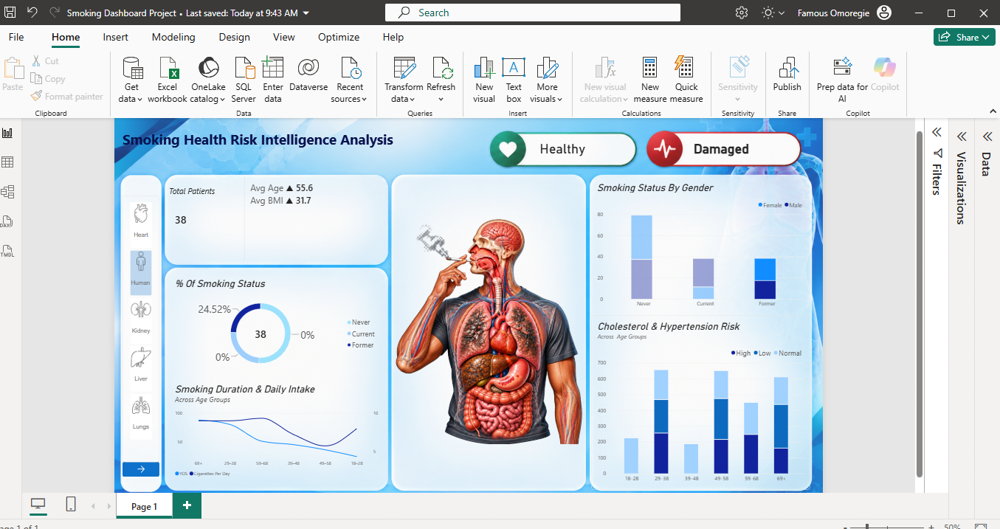
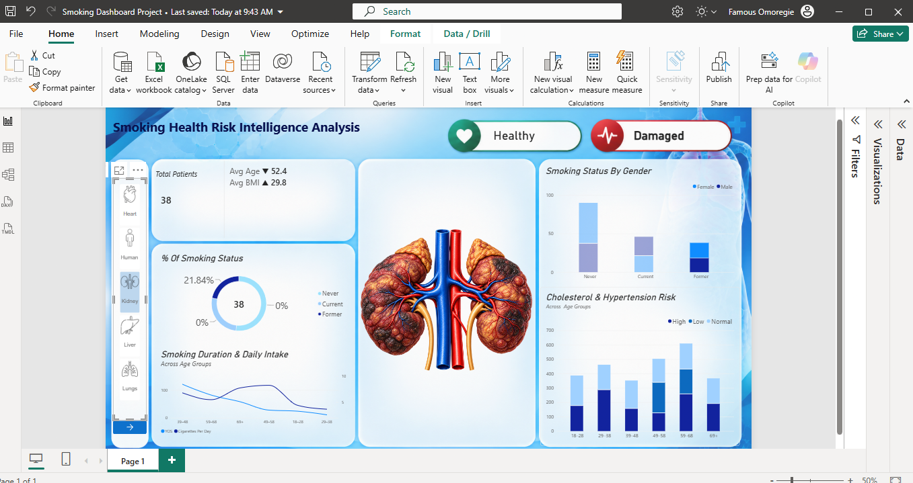
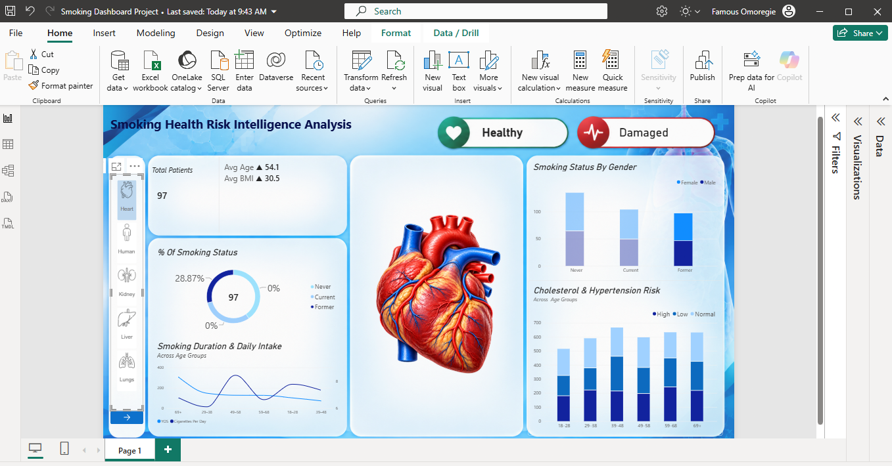

# Smoking Health Risk Analysis

## Project Overview

The Smoking Health Risk Analysis project explores the relationship between smoking behaviour, demographic characteristics and selected health indicators using Microsoft Power BI.

The project presents an interactive dashboard that allows users to explore smoking status, smoking duration, daily cigarette intake, BMI, cholesterol and hypertension indicators across different age groups and genders. An organ-selection interface and health-condition filters provide additional ways to explore the available data.

The aim is to demonstrate practical skills in data visualisation, interactive reporting and public health data interpretation. The analysis focuses on patterns and differences within the dataset and does not establish causal relationships between smoking and health outcomes.

https://github.com/user-attachments/assets/fe3e0829-0c4a-4562-be99-7bd97027781e

## Project Objectives

- Explore the distribution of smoking status.
- Examine smoking patterns across different age groups.
- Compare smoking status by gender.
- Explore cholesterol and hypertension indicators across age groups.
- Demonstrate interactive data visualisation using Power BI.

## Tools and Technologies

- Microsoft Power BI
- Power Query
- DAX
- Data Visualisation

## Dashboard Features

- Key performance indicator (KPI) cards.
- Smoking status distribution.
- Smoking duration and daily cigarette intake analysis.
- Smoking status comparison by gender.
- Cholesterol and hypertension risk analysis.
- Interactive organ selection and condition controls.

## Dataset

The dataset was provided as part of a course. It is included in this project with permission to share.

## Key Findings

- Current, former, and never smokers represented
  different proportions of the dataset.
- The distribution of organ conditions varied across
  the smoking categories.
- Differences in selected health indicators were
  explored across demographic groups.

## Limitations

- The analysis is based on the available dataset and may not represent the wider population.
- The findings describe patterns and associations but do not establish causation.
- The analysis is limited to the variables available in the dataset.
- The accuracy of the findings depends on the quality and reliability of the underlying data.

## Author

Famous Omoregie

## Dashboard Preview

### Full Dashboard

### Healthy Condition

### Kidney Analysis

### Heart Analysis

